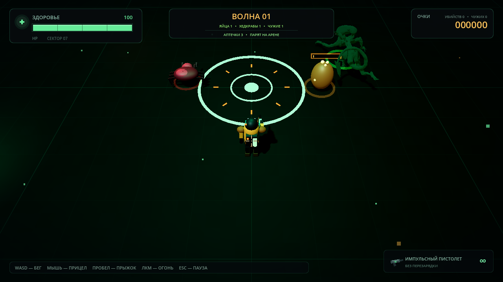
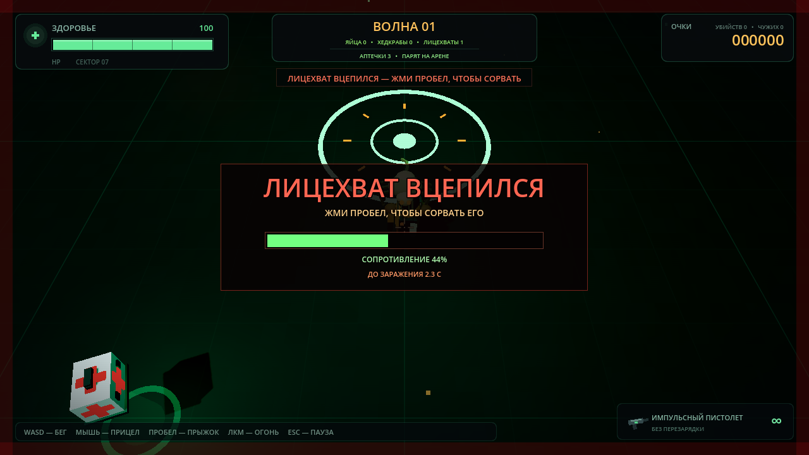
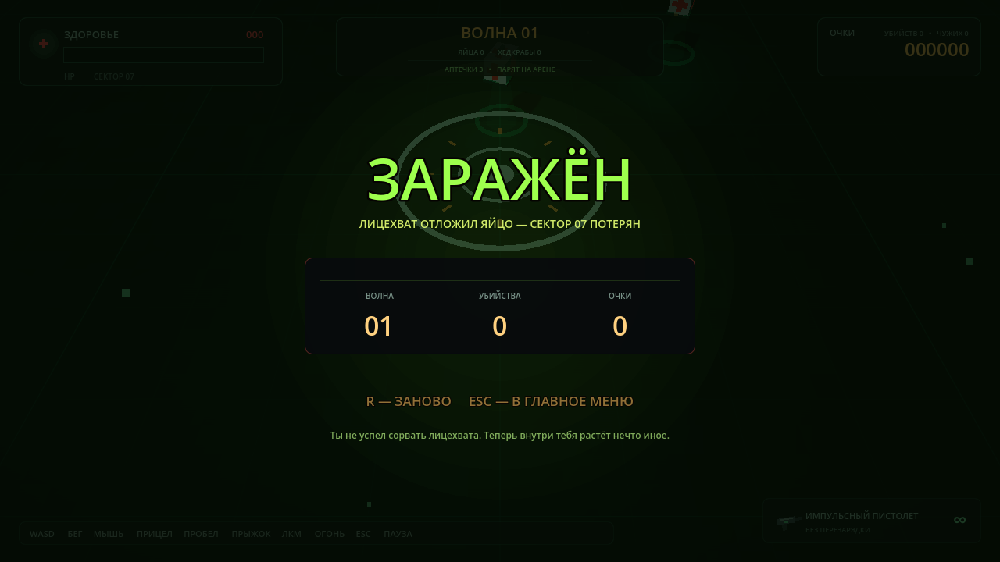
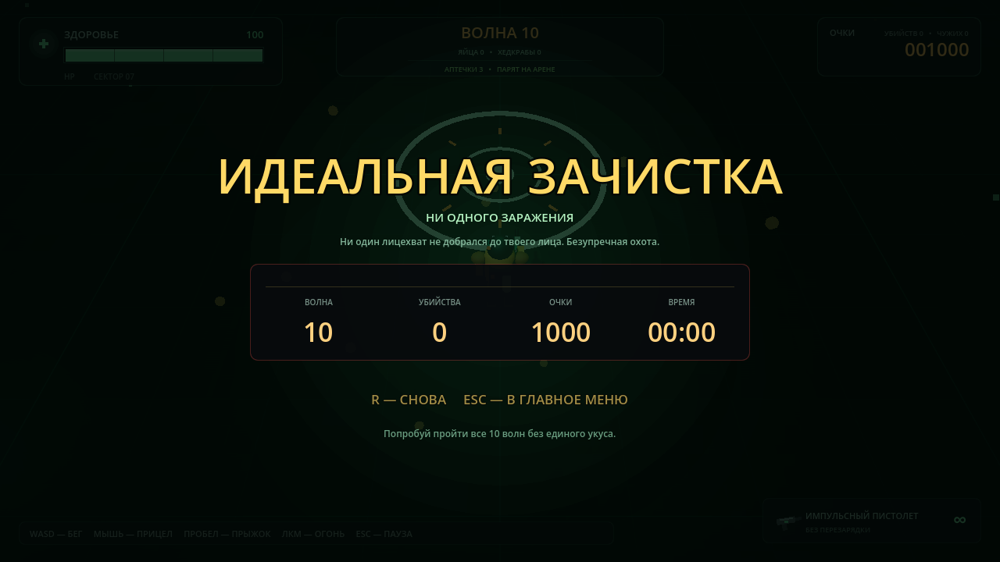

# Убить все яйца и выжить 3D


Полноценный 3D-экшен-выживалка на Godot 4.7. Арена, игрок, яйца, хедкрабы, эффекты и звуки создаются процедурно прямо в коде. Чужие используют скачанные 3D-модели: у «Бегуна» есть готовые анимации, а Xenomorph анимируется процедурно. При запуске открывается главное меню с настройками, которые сохраняются между сессиями.

## Скриншоты



| Захват лицехватом | Заражение | Победа |
|:---:|:---:|:---:|
|  |  |  |

Другие варианты победы: [эвакуация](docs/screenshots/victory-evac.png) и [на грани](docs/screenshots/victory-pyrrhic.png).

## Запуск

```bash
godot --path .
```

Или откройте папку проекта в Godot и нажмите **F5**.

### Требования

- [Godot Engine 4.7](https://godotengine.org/download) или новее (проект собран на 4.7.2).
- Видеокарта с поддержкой OpenGL 3.3+.
- Скачанные модели уже лежат в `assets/models`, дополнительно ничего устанавливать не нужно.

## Управление

| Клавиша | Действие |
|---|---|
| `W` / `A` / `S` / `D` или стрелки | Бег по арене |
| Мышь | Прицеливание (лазерный луч и маркер на полу) |
| ЛКМ | Огонь |
| `Пробел` | Прыжок; при захвате лицехватом — сопротивление, чтобы сорвать его |
| `Esc` | Пауза / продолжить; после смерти — в главное меню |
| `M` | Из паузы — в главное меню |
| `R` | Заново после смерти |
| Мышь / стрелки / `Tab` в меню | Навигация по пунктам |
| `Enter` / `Пробел` в меню | Подтвердить пункт |

## Главное меню и настройки

При запуске открывается главное меню с кнопками **ИГРАТЬ**, **НАСТРОЙКИ**, **УПРАВЛЕНИЕ** и **ВЫХОД**. Меню нарисовано процедурно, а за ним видна 3D-арена. Работает навигация мышью и клавиатурой.

В настройках доступны:

- **Громкость** — общий уровень звука.
- **Тряска камеры** — сила дрожания камеры при выстрелах и получении урона; можно отключить полностью.
- **Полноэкранный режим** — переключение между окном и полным экраном.
- **Лазерный прицел** — показывать луч и маркер прицела на полу.

Изменения применяются сразу и сохраняются в `user://settings.cfg`. Кнопка **СБРОСИТЬ** возвращает значения по умолчанию.

## Правила

- Яйца падают с потолка арены, приземляются и через некоторое время вылупляются. При полном естественном вылуплении из обычного яйца выходят **два взрослых хедкраба**.
- Яйцо выдерживает три попадания. После первого и второго появляются трещины, а над яйцом видна полоска таймера вылупления.
- Если разбить яйцо выстрелами, из него вырвутся **два недокраба**: они меньше взрослых, у них 1 HP, и они наносят меньше урона.
- Взрослые хедкрабы преследуют игрока, прыгают и наносят контактный урон. Чем выше волна, тем они крепче и быстрее.
- **С волны 3 появляются яйца лицехватов.** Они отличаются янтарным свечением и шипами. Разбитое яйцо выпускает одного лицехвата, а естественно вылупившееся — двух.
- **Лицехват** — маленький и очень быстрый враг: он догоняет игрока, прыгает на лицо и вцепляется. Пока он держится, стрелять нельзя. Жмите `Пробел`, чтобы заполнить шкалу сопротивления и сорвать его: за это дают бонусные очки.
- Если не сорвать лицехвата за **4 секунды**, игрок заражается, и игра заканчивается концовкой «Заражён».
- **С волны 2 на арену выходят чужие.** Они крупнее и живучее хедкрабов, быстрее сближаются и наносят серьёзный контактный урон. За убийство чужого дают больше очков.
- **С волны 4 появляются «Бегуны»** — более быстрый и агрессивный вариант чужого. Оба типа чужих видны в счётчике волны в верхней панели.
- Полоска здоровья находится в левом верхнем углу. После зачистки волны игрок получает немного здоровья.
- **На арене постоянно парят аптечки.** Партия из трёх штук появляется в случайных точках в пределах арены. Коснитесь аптечки, чтобы восстановить 30 HP.
- Каждая аптечка исчезает через 2 минуты. Когда исчезает последняя, через 20 секунд появляется новая партия из трёх штук.
- Волны становятся сложнее: яиц больше, они быстрее вылупляются, а врагов становится больше. За убийства, разбитые яйца и зачистку волн начисляются очки.
- **Финальная волна — десятая.** После зачистки всех яиц, хедкрабов, чужих и лицехватов показывается экран победы с одной из концовок.

## Концовки

В игре пять концовок:

| Концовка | Условие |
|---|---|
| **Идеальная зачистка** | Победить на 10-й волне с полным здоровьем и без единого захвата лицехватом. |
| **Эвакуация** | Победить на 10-й волне в обычном состоянии. |
| **На грани** | Победить, когда после лечения за волну у игрока остаётся не больше 25% здоровья. |
| **Вы погибли** | Погибнуть от хедкраба или чужого. |
| **Заражён** | Не сорвать лицехвата и погибнуть от заражения. |

## Особенности 3D-версии

- Арена 44 × 44 с процедурным полом, стенами, аварийным освещением, туманом и декоративными вышками.
- Камера от третьего лица сверху следует за игроком; прицел мыши проецируется на пол и врагов.
- Стрельба — мгновенный рейкаст с трассером, вспышкой, частицами и отдачей.
- Модель игрока собрана из примитивов и анимирована: бег, прыжок, поворот к прицелу, отдача оружия.
- У хедкрабов шесть анимированных лап, клешни, прыжки, полоски здоровья и пульсирующие кольца на полу для читаемости.
- Яйца падают, пружинят при приземлении, покачиваются, трескаются и меняют свечение по мере вылупления.
- **Xenomorph** — детализированная скачанная модель с зелёным свечением, процедурным покачиванием, наклоном при беге и выпадом при атаке.
- **«Бегун»** — скачанная скелетная модель Quaternius с анимациями `Idle`, `Run`, `Punch`, `HitReact` и `Death`.
- **Лицехваты** собраны из примитивов: продолговатое тело, шесть лап, длинный сегментированный хвост и светящиеся глаза. Они подсвечиваются янтарным кольцом и имеют отдельный счётчик в HUD.
- При захвате лицехватом появляется шкала сопротивления, таймер до заражения и красная виньетка; модель игрока дрожит.
- Чужие подсвечиваются пульсирующим кольцом на полу, имеют полоску здоровья и отдельный счётчик в HUD.
- Аптечки — парящие белые ящики с красными крестами, зелёным свечением, лучом и кольцом на полу. Они покачиваются, вращаются и мигают перед исчезновением.

## Технические детали

- `scripts/main.gd` — 3D-арена, освещение, волны, камера, спавн, прицел, игровой цикл и возврат в главное меню.
- `scripts/main_menu.gd` — процедурное главное меню: кнопки, страницы настроек и управления, навигация мышью и клавиатурой.
- `scripts/settings.gd` — автозагрузка настроек: громкость, тряска камеры, полноэкранный режим и лазерный прицел; сохранение в `user://settings.cfg`.
- `scripts/player.gd` — `CharacterBody3D`: движение, прыжки, рейкаст-стрельба, здоровье, состояние захвата лицехватом, сопротивление и заражение, процедурная модель.
- `scripts/egg.gd` — падение, приземление, трещины, таймер вылупления, два типа яиц и разбиение на недокрабов или лицехватов.
- `scripts/headcrab.gd` — ИИ преследования, шесть лап, прыжки, контактный урон, здоровье.
- `scripts/facehugger.gd` — лицехват: быстрый ИИ, прыжки, захват лица, срыв, здоровье и смерть.
- `scripts/alien.gd` — чужие: загрузка скачанных моделей, варианты `xeno` и `runner`, ИИ преследования, атака, урон, смерть.
- `scripts/medkit.gd` — парящие аптечки: случайный спавн, подбор, лечение, двухминутный таймер жизни и исчезновение.
- `scripts/hud.gd` — игровой интерфейс: здоровье, волны, счётчики яиц/хедкрабов/чужих/лицехватов/аптечек, шкала сопротивления, пауза, экраны смерти, заражения и победы с вариантами концовок.
- `scripts/sfx.gd` — процедурный синтез звуков, включая рык и смерть чужого, появление и подбор аптечки, визг лицехвата, борьбу, заражение и победу.
- `scripts/effects.gd` — `CPUParticles3D`, трассеры, ударные кольца и всплывающие очки (`Label3D`).
- `scripts/ambient.gd` — дрейфующие споры и пыль.
- `scripts/mesh_factory.gd` — общие хелперы для создания примитивов и материалов.
- `shaders/floor.gdshader` — процедурная сетка и разметка пола.
- `shaders/vignette.gdshader` — экранная виньетка.
- `scenes/main.tscn` — главная сцена с корнем `Node3D`.
- `assets/models/xenomorph.glb` — модель Xenomorph.
- `assets/models/quaternius/alien_big.gltf` — анимированная модель Big Alien.

Физические слои: `World` — слой 1, `Enemies` — слой 2, `Player` — слой 3. Выстрелы используют рейкаст по маске `World + Enemies`.

## Лицензия

Код игры и оригинальные процедурные ассеты распространяются под лицензией **MIT** — см. [LICENSE](LICENSE). Игру можно использовать, изменять и распространять при сохранении уведомления об авторстве.

Сторонние 3D-модели не входят в MIT и распространяются по своим лицензиям:

- **Xenomorph** by **Slaan** — [Poly Pizza](https://poly.pizza/m/0Dia0TyI_Uh), лицензия [CC BY 3.0](https://creativecommons.org/licenses/by/3.0/). Модель используется как основной «Чужой».
- **Ultimate Monsters** by **Quaternius** — [quaternius.com](https://quaternius.com/packs/ultimatemonsters.html), лицензия [CC0](https://creativecommons.org/publicdomain/zero/1.0/). Модель Big Alien используется как «Бегун»; анимации взяты из этого пака.

Полные уведомления и ссылки — в [THIRD_PARTY_NOTICES.md](THIRD_PARTY_NOTICES.md).

## Тесты

```bash
godot --headless --path . res://tests/test_game.tscn
```

Смоук-тесты проверяют главное меню и его страницы, старт игры из меню, настройки громкости, тряски камеры и лазерного прицела, движение, прыжок, получение урона и неуязвимость, падение яйца, три попадания, появление двух недокрабов, естественное вылупление двух взрослых хедкрабов, убийство недокраба, попадание по взрослому хедкрабу, паузу, контактный урон хедкраба и чужого, загрузку модели Xenomorph, урон и смерть чужого, награду за убийство, наличие анимаций у «Бегуна», спавн чужого в волне, завершение волны только после смерти последнего чужого, появление трёх аптечек, их парение в пределах арены, подбор с лечением, исчезновение по таймеру и новую партию через 20 секунд. Отдельный блок проверяет яйца лицехватов (падение, три попадания, одного лицехвата из разбитого яйца и двух из вылупившегося), урон и смерть лицехвата, захват игрока, невозможность застрелить прикреплённого лицехвата, срыв через `Пробел` с бонусными очками, завершение волны только после смерти лицехвата, финальную 10-ю волну и все варианты победы (`perfect`, `evac`, `pyrrhic`), а также заражение и обычную смерть (`infected`, `dead`). Всего **89 проверок**; последний прогон — **89 PASS, 0 FAIL**.

## Автор

**nmsys1k** (GitHub: [@b0unc3r-nm](https://github.com/b0unc3r-nm)). Проект создан на Godot Engine 4.7.
